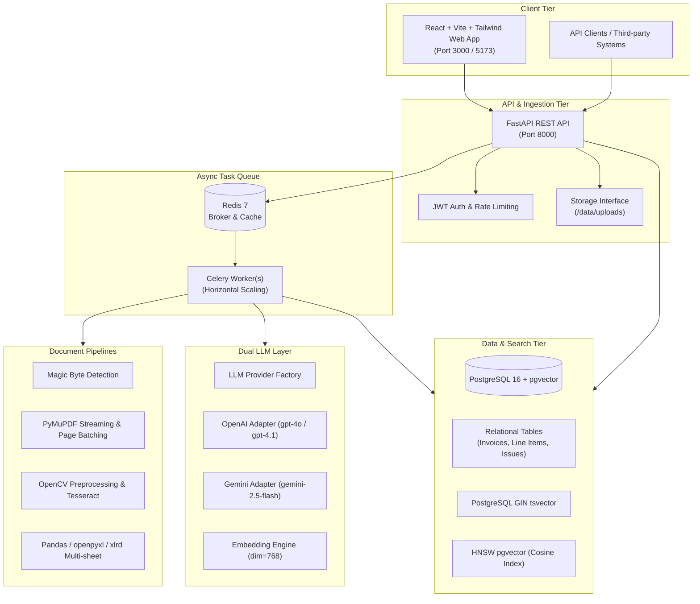

# System Architecture

## Overview
The AI-Powered Document Intelligence System is a resilient, scalable, multi-tenant document processing platform capable of processing high-volume financial documents (PDFs up to ~1,000 pages, scanned images, multi-sheet Excel files, CSVs), extracting structured financial data using a dual-provider LLM abstraction (OpenAI & Gemini), validating business and calculation logic, and providing hybrid keyword/semantic search.

## High-Level Architecture Diagram

## Processing Flow
1. **Intake & Hashing**: Upload streamed in chunks, SHA-256 computed on the fly, stored at `/data/uploads/<uuid>/<uuid>.<ext>`.
2. **Detection**: Magic byte verification detects file format independent of client extension.
3. **Queueing**: Asynchronous job queued in Redis via Celery. Fast 202 Accepted response returned.
4. **Processing**: Document parsed page-by-page (PyMuPDF for digital/OCR fallback, OpenCV+Tesseract for images, pandas for spreadsheets).
5. **AI Extraction**: Extracted text segmented and passed to active LLM provider (or mapped directly for structured spreadsheets) using strict Pydantic schemas.
6. **Validation Engine**: Mathematical, missing field, tax anomaly, and duplicate detection rules evaluated. Manual review flagged if necessary.
7. **Indexing**: Invoices and chunks indexed into PostgreSQL full-text tsvector and embedded with pgvector.
