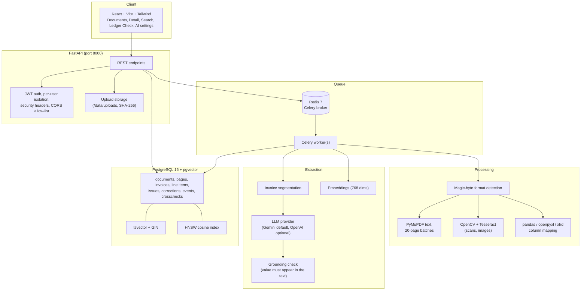

# System Architecture

## Overview
A document intelligence system for financial documents: PDFs (up to 1,000 pages), scans, images, XLSX/XLS and CSV. It extracts invoice data with an LLM, validates the numbers, lets a user review and correct the result, compares invoices against a ledger, and makes everything searchable.

The LLM is Gemini by default (`gemini-2.5-flash`). The provider sits behind a small interface, so OpenAI works too. The provider, model and API key can be set from the UI.

## Diagram

## Processing flow

1. **Upload.** The file is streamed to disk in chunks and hashed with SHA-256 on the way. The format is found from the file's magic bytes, not its extension. Limits for size, pages, image pixels and sheet rows are enforced. The API answers `202` and the document is stored with status `uploaded`.
2. **Start.** Processing starts when the user starts it (UI button, or `POST /documents/{id}/reprocess`). This is deliberate: it asks for consent before any file text is sent to an LLM provider. The document moves to `queued`.
3. **Process (`processing`).** PDFs are read page by page with PyMuPDF; a page with too little text falls back to OCR. Images go through OpenCV preprocessing (grayscale, deskew, denoise, upscale) and Tesseract. If the first OCR read is weak, a second read without thresholding is tried and the better one is kept. Spreadsheets become one page per sheet. Large PDFs are split into 20-page batches that run as a Celery group. A failed page does not fail the document unless every page fails.
4. **Extract (`extracting`).** The text is split into invoices (heuristics), then sent to the LLM in JSON mode at temperature 0, with the reply schema in the prompt; the reply is validated against a Pydantic model. Spreadsheets are mapped to invoices directly: a synonym table maps columns, and the LLM is only asked when the headers are unclear. Each value must be backed by a verbatim snippet. A grounding check confirms the snippet is in the document text; a value that is not found gets low confidence and a review reason.
5. **Validate (`validating`).** Rules run on every invoice (below). The document becomes `completed`, or `needs_review` if any invoice is flagged.
6. **Index.** Each invoice gets a summary chunk, and pages are chunked too. Chunks get a `tsvector` for keyword search and an embedding for semantic search. Embedding failure does not fail the document; keyword search still works.
7. **Review.** The user edits invoice fields and line items. Each edit is saved as a correction, the invoice is re-validated, and the search index for it is rebuilt. Values flagged "not found in the document text" can be marked as correct.

Retries use backoff only for errors marked retryable; permanent errors fail at once with a stable error code and a friendly message. A failed document can be reprocessed.

## Validation rules

| Code | Meaning |
|---|---|
| `MISSING_FIELD` | A vital field is missing: invoice number, date, supplier, customer, total or currency. |
| `TOTAL_MISMATCH` | Subtotal + tax (minus discount) does not equal the total. |
| `LINE_SUM_MISMATCH` | Line totals do not add up to the subtotal. |
| `LINE_MATH_MISMATCH` | Quantity x unit price does not equal a line total. |
| `TAX_ANOMALY` | Tax is negative, larger than the subtotal, or above the maximum rate. |
| `NEGATIVE_AMOUNT` | An amount is negative. |
| `FUTURE_DATE`, `OLD_DATE` | The invoice date is in the future or more than 10 years old. |
| `LOW_CONFIDENCE` | The model was unsure about a vital field. |
| `DUPLICATE_INVOICE` | Same supplier and invoice number already exists in another document. |

Amounts are compared with a tolerance of `max(0.02, 0.1%)`. An invoice with any issue is flagged for manual review.

## Ledger Check (cross verification)

Two processed documents are compared invoice by invoice. Invoices are paired by invoice number plus supplier, then by number alone, then by "the only one left on each side". Differing fields are listed, and invoices with no partner appear under "only in A" or "only in B". Any pair of formats works, because both sides are stored as structured invoices. Results are saved in `crosschecks`.

## Design decisions

| Decision | Reason |
|---|---|
| Python, FastAPI and Celery | Best OCR and document libraries are in Python; Celery gives retries and groups. |
| PostgreSQL with pgvector | One database for relational data, full-text search and vectors. No separate vector service to run. |
| Redis | Celery broker; simple and fast. |
| Gemini default, provider interface | One key is enough to run. The interface keeps the LLM swappable. |
| JSON mode, schema validation and grounding | Missing values stay empty instead of being invented, and every value is traceable to the text. |
| Rules in code, not in the LLM | Arithmetic checks must be deterministic and testable. |
| Manual start | Consent before sending document text to an external provider. |
| Keyword and semantic search as separate modes | Simple to explain and test. |

## Scalability and reliability

- The API is stateless; workers scale by adding Celery workers (`--concurrency` per worker).
- Memory stays bounded: uploads are streamed, PDF pages are processed and saved in 20-page batches, and spreadsheets have a row limit.
- Heavy work (OCR, LLM calls, embeddings) runs in the background, so the API answers quickly.
- Every stage is idempotent, so a retry or reprocess replaces earlier results.
- Processing history is stored per document in `processing_events`.

## Security

- JWT with expiry, bcrypt password hashes, and every query filtered by the owner (another user's document returns `404`).
- Upload checks: magic-byte format detection, size, page, pixel and row limits, decompression-bomb guard.
- CORS allow-list, security headers (`nosniff`, `X-Frame-Options`, `Referrer-Policy`), correlation id on every request.
- The LLM key saved from the UI is stored in a file with owner-only permissions and never returned by the API. A production deployment would use a secrets manager.
- The extraction prompt tells the model to treat document text as data, not instructions.
- The app refuses to start in production with the default JWT secret.
- The API and worker containers run as a non-root user.

## Not built

Rate limiting, hybrid (combined) search ranking, LLM-vision fallback for poor scans, and frontend tests. See the README limitations.
