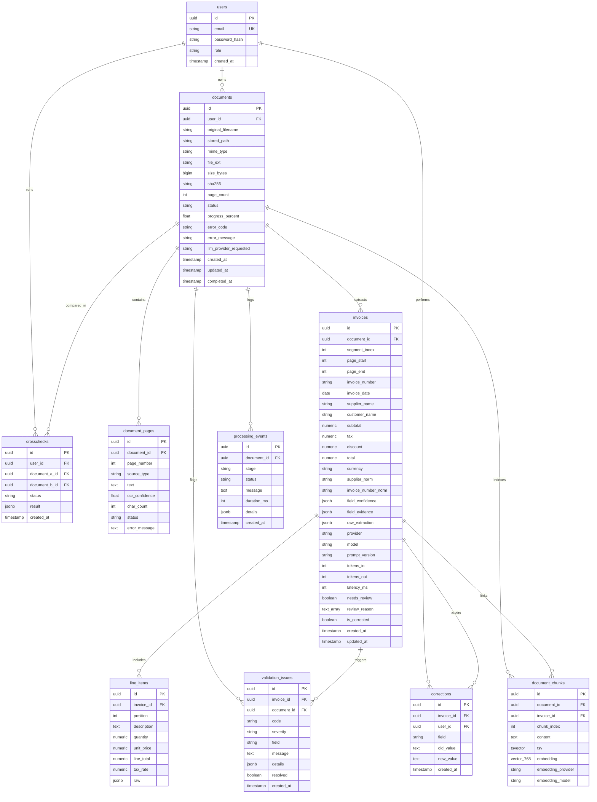

# Database Schema & Data Models

## Entity Relationship Diagram

## Key Indexes
- `documents(user_id, status)`: filtered document lists.
- `documents(sha256)`: duplicate file detection.
- `invoices(supplier_norm, invoice_number_norm)`: duplicate invoice detection across documents. Every query also filters by the owner through `documents.user_id`.
- `invoices(invoice_date)`, `invoices(total)`: date and amount filters.
- `document_chunks.tsv`: PostgreSQL GIN index for full-text search.
- `document_chunks.embedding`: HNSW cosine index for pgvector semantic search (`vector_cosine_ops`).

## Notes
- Money is `NUMERIC(18,4)`; the API returns two decimals.
- `crosschecks.result` holds the whole comparison (summary, pairs, only-in-A, only-in-B) as JSON, so a saved result is returned as it was computed.
- `corrections` is an audit trail: every manual edit stores the old and new value.
- `document_chunks.embedding_provider` and `embedding_model` record which model made each vector; semantic search only uses vectors from the active model.
- Migrations: `0001` pgvector extension, `0002` core tables, `0003` crosschecks, `0004` invoice discount.
